  

I currently work on [Bitkey](https://github.com/proto-at-block/bitkey), which is open source.

**Recent thoughts:**

<!-- BLOG-POST-LIST:START -->
- [Who is code style for in the AI era?](https://cameronwillia.ms/thoughts/who-is-code-style-for/) · Nov 15, 2026 Linters and formatters exist so people can read each other’s code, but we are writing and reading way less of it.
<!-- BLOG-POST-LIST:END -->

---

> *Somewhere, something incredible is waiting to be known.*
>
> — Sharon Begley, in a 1977 *Newsweek* profile of Carl Sagan
